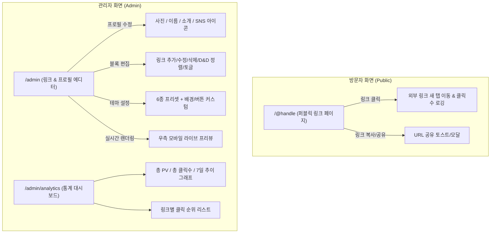

# [PRD] 마이링크 (MyLink) 제품 기능 정의서

**버전**: v1.3.0 (shadcn/ui 기반 토스 디자인 시스템(TDS) 구축 사양 확정)  
**작성일**: 2026-09-30  
**최종 수정**: 2026-10-07  
**상태**: 확정 (Approved)  
**타깃 플랫폼**: 모바일 퍼스트 반응형 웹 (Next.js 16, React 19, Tailwind CSS v4, shadcn/ui)  
**디자인 시스템**: 공식 **shadcn/ui** (https://ui.shadcn.com/) 아키텍처 기반 + **`design.md` 토스 디자인 시스템 (TDS)** 1:1 완벽 이식 및 구축  
**전역 상태 관리**: Zustand v5 (`persist` 미들웨어 기반 LocalStorage 자동 동기화)  
**데이터 저장소**: 브라우저 LocalStorage 기반 (추후 DB 확장 가능 구조)  

---

## 1. 프로젝트 개요 (Overview)

### 1.1 서비스 소개
**마이링크(MyLink)**는 인스타그램, 유튜브, 틱톡 등 다양한 소셜 미디어에서 활동하는 크리에이터와 인플루언서를 위한 **한국형 멀티 링크(바이오 링크) 서비스**입니다.  
프로필 단 하나에만 링크를 걸 수 있는 소셜 미디어 환경의 한계를 극복하고, 자신의 대표 채널, 동영상, 협업 문의, 쇼핑몰/후원 링크를 하나의 감각적인 모바일 페이지로 집약하여 제공합니다.

### 1.2 기획 배경 및 페인 포인트
- **SNS 링크 제한**: 인스타그램 등 주요 SNS는 프로필 소개란에 단 하나의 링크만 허용하여 여러 채널이나 콘텐츠를 알리기 어려움.
- **복잡한 링크 관리**: 여러 개의 외부 플랫폼 링크가 흩어져 있어 팔로워 및 비즈니스 파트너의 이탈률이 높음.
- **성과 측정 부재**: 어떤 링크가 팬들에게 가장 관심을 받고 클릭되었는지 정량적으로 파악하기 어려움.
- **MVP 단계의 간편성**: 별도의 복잡한 회원가입이나 서버 설정 없이, 로컬 브라우저 환경에서 즉시 생성/편집/확인할 수 있는 가벼운 사용성 요구.

### 1.3 단계별 시연 개발 전략 (Phased Demo Scope)
본 프로젝트는 단계적 시연(Live Demonstration) 프로세스에 맞춰 개발 범위를 명확히 분리합니다.

- **🎯 Phase 1 (현재 시연 집중 단계 - Profile MVP)**:
  - **목표**: 별도의 대시보드나 통계 기능 없이, **브라우저 LocalStorage를 활용한 반응형 '프로필 페이지(바이오 링크 뷰어)'** 완성을 최우선으로 진행.
  - **포함 범위**:
    1. LocalStorage 기반 데이터 모델 및 시드 데이터 연동
    2. 크리에이터 프로필 카드 (원형 아바타, 이름, 한 줄 소개)
    3. 소셜 미디어 아이콘 바 (YouTube, Instagram, X 등)
    4. 콘텐츠 블록 렌더링 (URL 링크 버튼 + 섹션 구분 헤더)
    5. 모바일 최적화 반응형 레이아웃 및 shadcn/ui 기반 미니멀 디자인 (토스 TDS 컬러 토큰 융합)
- **⏳ Phase 2 (추후 확장 단계 - Future Milestones)**:
  - 좌/우 실시간 관리자 에디터 (`/admin`) 및 드래그 앤 드롭 정렬
  - 테마 6종 커스터마이징
  - 방문자(PV) 및 링크별 클릭 통계 대시보드 (`/admin/analytics`)

### 1.4 핵심 가치 제안 (Value Proposition)
> **"단 3분 만에 완성하는 크리에이터 맞춤형 브랜드 멀티링크 & 가벼운 로컬 기반 프로필"**
- **로컬 스토리지 기반 간결성**: 복잡한 서버/DB 설정 없이 브라우저 자체 스토리지로 즉시 구동.
- **크리에이터 맞춤 블록**: 프로필 + SNS 아이콘 바 + URL 링크 버튼 + 섹션 구분 헤더.
- **shadcn/ui 기반 미니멀 디자인**: shadcn/ui 컴포넌트 시스템과 토스 감성 UI/UX를 결합하여 신뢰감 있는 모바일 퍼스트 인터페이스 제공.

### 1.5 기술 스택 및 라이브러리 (Tech Stack)
| 계층 | 기술 / 라이브러리 | 버전 | 선정 이유 및 역할 |
| :--- | :--- | :---: | :--- |
| **Framework** | Next.js (App Router) | 16.x | 최신 React 19 지원, 파일 기반 라우팅(`/`, `/admin`, `/admin/analytics`) 및 번들 최적화 |
| **Language** | TypeScript | 5.x | 엄격한 타입 정의로 프로필/블록/통계 스키마 무결성 보장 및 런타임 오류 방지 |
| **Design System** | **shadcn/ui** (공식 표준, Base UI 기반) | 최신 | **[UI 디자인 표준 베이스]**<br>- 향후 모든 UI/UX 디자인 및 컴포넌트 개발은 공식 [shadcn/ui](https://ui.shadcn.com/)를 단일 표준으로 진행<br>- Tailwind CSS v4 완전 호환 및 `components.json` 기반 중앙 관리<br>- 필요 컴포넌트는 `npx shadcn@latest add` CLI로 도입하여 일관성 유지<br>- 임의의 독자 커스텀 컴포넌트 남발을 방지하고 shadcn/ui 컴포넌트 소스를 TDS 디자인 토큰과 결합하여 커스터마이징 |
| **Design Theme** | **Toss Design System (TDS)** | `design.md` 기반 | shadcn/ui 컴포넌트 위에 TDS 비주얼 언어 적용. 컬러·타이포그래피·라운드·모션·그림자를 `globals.css`의 CSS 변수로 완전 매핑. 별도 TDS 패키지 의존 없이 CSS-only로 구현 |
| **Styling** | Tailwind CSS | 4.x (최신) | CSS-first 방식 (별도 config 파일 불필요). `@theme inline` 블록에서 TDS 토큰을 Tailwind 유틸리티로 노출 |
| **State Management** | **Zustand** | 5.x | **[전역 상태 관리 핵심]**<br>- `persist` 미들웨어 내장으로 브라우저 `localStorage`와 자동 양방향 동기화<br>- 선택적 구독(Selector)을 통한 실시간 모바일 프리뷰 초고속 리렌더링 최적화<br>- 약 1KB의 초경량 번들 및 보일러플레이트 제로<br>- 추후 Supabase/서버 DB 연동 시 스토어 내부 구현만 변경하여 손쉽게 마이그레이션 가능 |
| **Icons** | Lucide React | 최신 | TDS 아이콘 시스템의 프로토타입 대체재. 24px 그리드·1.5px stroke·rounded caps로 TDS 아이콘과 동일 격자. 미니멀하고 일관된 SVG 아이콘 세트 |
| **Drag & Drop** | @hello-pangea/dnd (또는 HTML5 D&D) | 최신 | 링크 및 헤더 블록의 직관적인 드래그 앤 드롭 순서 변경 |
| **Persistence** | Browser LocalStorage | W3C Standard | 별도 외부 DB나 백엔드 서버 없이 브라우저 내에서 즉각 구동 및 영속성 보장 |

---

## 2. 타깃 사용자 및 핵심 시나리오 (Target & User Scenarios)

### 2.1 타깃 페르소나 정의 (Target Persona)
| 항목 | 상세 내용 |
| :--- | :--- |
| **타깃 사용자** | 유튜브, 인스타그램, 틱톡, 블로그 등을 운영하는 크리에이터, 1인 창작자, 인플루언서 |
| **주요 니즈** | 1. 팔로워에게 내 최신 영상, 블로그, 후원/마켓 링크를 깔끔하게 전달<br>2. 내 브랜드 분위기에 맞는 깔끔하고 세련된 프로필 디자인 구성<br>3. 어떤 링크가 클릭을 많이 받는지 확인하여 콘텐츠 방향성 수립 |
| **이용 환경** | - 방문자: 90% 이상 모바일 기기(iOS Safari, Android Chrome, 인앱 브라우저)<br>- 관리자(크리에이터): 데스크톱 및 모바일 웹 환경에서 링크 수정 및 통계 확인 |

### 2.2 핵심 사용자 시나리오 (User Scenarios)

#### 🎬 시나리오 1: 크리에이터의 프로필 페이지 탐색 및 확인 (Phase 1 시연 핵심)
- **페르소나**: 테크 및 일상 크리에이터 '민지'
- **목표**: SNS 팔로워들에게 여러 채널 링크를 모아 제공할 수 있는 모바일 최적화 바이오 링크 확인
- **주요 흐름**:
  1. **접속**: 크리에이터는 브라우저를 통해 마이링크 웹 애플리케이션(`http://localhost:3000`)에 접속한다.
  2. **데이터 로드**: `localStorage`에 저장된 프로필 및 링크 블록 데이터가 지연 없이 브라우저에 렌더링된다.
  3. **프로필 탐색**: 최상단 원형 아바타, '크리에이터 민지' 타이틀, 채널 소개글 및 인스타그램/유튜브/이메일 SNS 아이콘 바를 확인한다.
  4. **콘텐츠 블록 탐색**: '🔥 대표 채널 & 최신 소식', '🛍️ 진행 중인 공구 & 추천 아이템' 등 섹션 헤더로 잘 정돈된 링크 버튼들의 가독성과 배치를 확인한다.
  5. **반응형 검증**: 모바일 화면(스마트폰 뷰포트) 비율로 카드와 버튼 여백이 터치하기 알맞게 최적화되어 있음을 체감한다.
- **기대 결과**: 별도 백엔드 연결 없이도 브라우저 로컬 저장소를 통해 매력적인 완성형 모바일 프로필 페이지를 즉각 시연 가능.

#### 👥 시나리오 2: 방문자(팔로워)의 링크 유입 및 콘텐츠 소비 (Phase 1 뷰어 경험)
- **페르소나**: 인스타그램 팔로워 '지훈'
- **목표**: 인스타그램 프로필 바이오 링크를 눌러 크리에이터의 최신 유튜브 영상 및 공구 아이템 확인
- **주요 흐름**:
  1. **유입**: 지훈은 인스타그램 스토리/프로필에서 마이링크 URL을 클릭하여 모바일 인앱 브라우저로 진입한다.
  2. **로딩**: 가볍고 빠른 초기 렌더링으로 0.5초 이내에 프로필 페이지가 로드된다.
  3. **관심 링크 발견**: 상단 추천 섹션의 [유튜브 최신 영상 보러가기] 링크 버튼을 탭한다.
  4. **외부 연결**: 버튼 터치 인터랙션(가벼운 스케일/눌림 효과)과 함께 새 창(New Tab)으로 유튜브 앱/웹이 즉시 실행된다.
  5. **재진입**: 뒤로 가기 후 '진행 중인 공구 마켓' 링크를 둘러보며 필요한 정보를 추가 탐색한다.
- **기대 결과**: 직관적인 모바일 UI로 이탈 없이 원하는 외부 목적지 채널로 매끄럽게 연결.

#### 🛠️ 시나리오 3: [Phase 2 확장] 링크 실시간 편집 및 테마 커스터마이징 (관리자 에디터)
- **페르소나**: 링크 구성을 업데이트하려는 크리에이터
- **목표**: 새로운 마켓 링크를 추가하고, 상단으로 순서를 변경한 뒤 분위기에 맞는 다크 테마 적용
- **주요 흐름**:
  1. **에디터 진입**: `/admin` 페이지로 접속하여 좌측 편집 패널과 우측 스마트폰 라이브 프리뷰를 확인한다.
  2. **링크 추가 & 수정**: [새 링크 추가]를 눌러 제목과 URL을 입력하고, 즉각 우측 스마트폰 화면에 반영되는 것을 확인한다.
  3. **드래그 앤 드롭 정렬**: 마우스로 링크 핸들을 잡아 상단으로 끌어올려 노출 순서를 재배치한다.
  4. **테마 변경**: 디자인 탭에서 'Modern Dark' 프리셋을 클릭하면 실시간 프리뷰가 다크 모드로 전환된다.
  5. **저장 & 공유**: `localStorage`에 자동 저장되며, '내 링크 복사' 버튼을 눌러 인스타그램 프로필에 등록할 URL을 복사한다.
- **기대 결과**: 코드 수정 없이 직관적인 GUI 에디터를 통해 실시간으로 링크 페이지를 완성 및 관리.

#### 📊 시나리오 4: [Phase 2 확장] 방문자 반응 측정 및 링크 성과 분석 (애널리틱스)
- **페르소나**: 콘텐츠 반응 및 공구 성과를 측정하려는 크리에이터
- **목표**: 어떤 링크가 팔로워들에게 가장 많은 클릭을 받았는지 분석하여 다음 협업 기획에 반영
- **주요 흐름**:
  1. **대시보드 진입**: `/admin/analytics` 페이지로 이동한다.
  2. **KPI 확인**: 누적 방문자 수(PV), 전체 링크 클릭 수, 전반 클릭률(CTR) 요약 지표를 확인한다.
  3. **인기 링크 순위 파악**: 링크 클릭 순위 테이블에서 '2026 데스크테리어 기획전' 링크가 전체 클릭의 45%를 차지하고 있음을 확인한다.
  4. **추이 분석**: 최근 7일간의 일별 방문/클릭 바 차트를 보며 프로모션 게시물을 올린 날 클릭이 급증했음을 검증한다.
- **기대 결과**: 정량적인 클릭 데이터를 기반으로 크리에이터 활동 및 수익화 전략을 수립.

---

## 3. 시스템 구조 및 화면 플로우 (Information Architecture)

### 3.1 화면 및 라우팅 구조


### 3.2 페이지별 역할
1. **퍼블릭 페이지 (`/` 또는 `/[handle]`)**
   - 모바일 화면 비율(최대 너비 480px) 중앙 배치
   - 프로필, 소셜 아이콘, 섹션 헤더, 링크 버튼 렌더링
   - 방문 시 페이지 뷰(PV) 1회 집계, 링크 클릭 시 로컬 통계 증가 후 새 창 이동
2. **에디터 페이지 (`/admin`)**
   - 데스크톱: 좌측 탭(프로필/링크/디자인) + 우측 실시간 모바일 목업 프리뷰 (Split View)
   - 모바일: 상단 탭으로 편집기 / 미리보기 전환 가능
3. **통계 대시보드 (`/admin/analytics`)**
   - 상단 요약 카드 (총 방문자 수, 총 링크 클릭 수, 평균 CTR)
   - 최근 7일 방문 및 클릭 트렌드 바 차트
   - 링크별 누적 클릭 순위 테이블

### 3.3 메인 화면 텍스트 와이어프레임 (Main Screen Wireframe)
> 📄 세부 컴포넌트 명세는 [docs/wireframe.md](file:///c:/Users/user/OneDrive/Desktop/2026-2학기/아이디어를%20현실로%20-%20바이브%20코딩/my-link-hy/docs/wireframe.md)를 참조하십시오.

```text
┌────────────────────────────────────────────────────────┐
│                        MyLink                          │
│                                           [ 공유 / 복사 ↗]│ <-- 상단 우측 공유 액션 버튼
│                                                        │
│                      ┌────────┐                        │
│                      │  (👤)  │  <-- 1. 원형 프로필 아바타 (88x88)
│                      └────────┘                        │
│                                                        │
│                    크리에이터 민지  [Creator]            │ <-- 2. 표시 이름 + 역할 뱃지
│          일상과 테크 라이프스타일을 기록합니다 ✨            │ <-- 3. 한 줄 소개(Bio)
│          비즈니스 문의는 아래 링크나 메일로 부탁드려요!       │
│                                                        │
│        [ ▶ ]    [ 📸 ]    [ 🎵 ]    [ 🐙 ]    [ ✉️ ]    │ <-- 4. 소셜 미디어 아이콘 바
│       YouTube   Insta    TikTok    GitHub    Mail      │    (등록된 플랫폼만 가로 정렬)
│                                                        │
│ ────────────────────────────────────────────────────── │
│                                                        │
│  🔥 대표 채널 & 최신 소식                                 │ <-- 5. 섹션 구분 헤더 1
│                                                        │
│  ┌──────────────────────────────────────────────────┐  │
│  │ [▶]  유튜브 채널 바로가기                  [인기]│  │ <-- 6. URL 링크 카드 1
│  │      매주 목요일 저녁 8시 신규 영상 업로드 🎥    ↗│  │    (아이콘 + 제목 + 설명
│  └──────────────────────────────────────────────────┘  │     + 뱃지 + 새창 화살표)
│                                                        │
│  ┌──────────────────────────────────────────────────┐  │
│  │ [📸] 인스타그램 일상 & 스토리                     │  │ <-- URL 링크 카드 2
│  │      실시간 라이프스타일과 비하인드 컷 📸        ↗│  │
│  └──────────────────────────────────────────────────┘  │
│                                                        │
│  🛍️ 진행 중인 공구 & 추천 아이템                         │ <-- 섹션 구분 헤더 2
│                                                        │
│  ┌──────────────────────────────────────────────────┐  │
│  │ [🛍️] 2026 데스크테리어 기획전           [한정 특가]│  │ <-- URL 링크 카드 3
│  │      제가 직접 써보고 검증한 추천 제품 모음 💻   ↗│  │
│  └──────────────────────────────────────────────────┘  │
│                                                        │
│  ┌──────────────────────────────────────────────────┐  │
│  │ [📝] 올인원 노션 생산성 템플릿 무료 배포           │  │ <-- URL 링크 카드 4
│  │      목표 관리와 루틴을 한눈에 정리하는 템플릿   ↗│  │
│  └──────────────────────────────────────────────────┘  │
│                                                        │
│  💬 협업 & 문의                                         │ <-- 섹션 구분 헤더 3
│                                                        │
│  ┌──────────────────────────────────────────────────┐  │
│  │ [✉️] 비즈니스 및 광고 협업 제안                   │  │ <-- URL 링크 카드 5
│  │      이메일 또는 제안서 링크로 연락 부탁드립니다 ↗│  │
│  └──────────────────────────────────────────────────┘  │
│                                                        │
│                                                        │
│                 ⚡ Powered by MyLink                   │ <-- 7. 하단 푸터 브랜딩
│             © 2026 MyLink. All rights reserved.        │
│                                                        │
└────────────────────────────────────────────────────────┘
```

---

## 4. 상세 기능 요구사항 (Functional Requirements)

### 4.1 프로필 관리 기능 (Profile Management)
- [x] **프로필 이미지 (Avatar)**:
  - 이미지 파일 업로드(로컬 Base64 저장) 또는 이미지 URL 직접 입력 지원
  - 미등록 시 기본 기본 아바타 아이콘 표시
  - 원형(Circular) 형태의 깔끔한 프레임 렌더링
- [x] **표시 이름 (Display Name)**:
  - 크리에이터 활동명 / 닉네임 입력 (최대 30자)
- [x] **한 줄 소개 (Bio)**:
  - 채널 소개 및 안내 문구 입력 (최대 120자, 줄바꿈 허용)
- [x] **소셜 미디어 아이콘 바 (Social Media Icons)**:
  - 지원 플랫폼: Instagram, YouTube, TikTok, X(트위터), GitHub, Mail, Threads, Chzzk(치지직)
  - 사용자가 URL을 입력한 플랫폼만 프로필 하단에 아이콘 버튼으로 가로 나열
  - 클릭 시 해당 SNS 프로필로 즉시 연결

### 4.2 콘텐츠 블록 관리 기능 (Content Block Management)
- [x] **지원 블록 타입**:
  1. **URL 링크 버튼 (Link Block)**:
     - 링크 제목 (Title, 필수)
     - 연결 대상 URL (http:// 또는 https:// 유효성 검증)
     - 보조 설명 (Subtitle, 선택)
     - 아이콘/썸네일 지정 (Lucide 아이콘 선택 지원)
  2. **섹션 구분 헤더 (Section Header Block)**:
     - 카테고리/그룹명 텍스트 (예: "🔥 추천 영상", "🛍️ 공구 마켓", "💬 소통 & 문의")
     - 링크 목록 사이에 시각적 분리선 및 소제목 역할
- [x] **순서 변경 (Reordering)**:
  - 블록 핸들을 통한 드래그 앤 드롭(Drag & Drop) 순서 변경
  - (모바일 대응) 위/아래 순서 이동 화살표 버튼 병행 지원
- [x] **노출 On/Off 토글 (Visibility Toggle)**:
  - 블록 우측 스위치 클릭 시 삭제하지 않고 퍼블릭 페이지에서 즉시 숨김/표시 전환
- [x] **블록 CRUD**:
  - 신규 블록 추가, 인라인 수정, 삭제 확인 팝업

### 4.3 디자인 및 테마 커스터마이징 (Theming & Styling)
- [x] **큐레이션 프리셋 테마 6종 (One-click Presets)**:
  1. **Toss Clean (Default)**: 깨끗한 화이트 배경, 토스 블루(`#3182F6`) 포인트, 부드러운 라운드 카드
  2. **Modern Dark**: 딥 그레이/블랙 배경, 미니멀한 다크 모드, 네온 화이트 텍스트
  3. **Soft Pastel**: 사랑스러운 소프트 핑크/라벤더 파스텔 그라데이션, 화이트 라운드 필 버튼
  4. **Warm Minimal**: 감성적인 아이보리/베이지 톤, 차분한 어스(Earth) 컬러 버튼
  5. **Neo Vibrant**: 트렌디한 바이올렛-인디고 그라데이션, 생동감 넘치는 쉐도우 효과
  6. **Monotone Sharp**: 흑백 고대비 미니멀리즘, 각진 모서리와 날렵한 테두리
- [x] **세부 커스텀 옵션 (Fine-tuning)**:
  - **배경**: 단색 컬러 피커 / 듀오톤 그라데이션 선택
  - **버튼 쉐입**: 둥근 모서리(`rounded-xl`), 완전 둥근 알약형(`rounded-full`), 각진 직사각형(`rounded-none`)
  - **버튼 스타일**: 솔리드 카드(Filled), 아웃라인(Outline), 입체 그림자(Elevated Shadow)

### 4.4 에디터 UX 및 반응형 경험 (Editor & Live Preview)
- [x] **스마트폰 목업 실시간 프리뷰**:
  - 에디터에서 텍스트를 입력하거나 토글을 누르면 우측 스마트폰 화면에 즉시 0.05초 내 동기화
- [x] **공유 및 내 링크 확인**:
  - 상단 "내 마이링크 열기" 버튼 (새 탭에서 실제 방문자 화면 오픈)
  - "링크 복사" 클릭 시 클립보드 복사 및 토스트 알림 안내
- [x] **초기 목업 데이터 제공 (Seed Data)**:
  - 최초 접속 시 빈 화면 대신 매력적인 크리에이터 예시 데이터(유튜브 링크, 인스타 아이콘, 공구 헤더 등)가 기본 로드되어 즉시 체험 가능

### 4.5 [Phase 2 확장] 방문자 및 클릭 성과 분석 (Analytics)
> ⚠️ **시연 1단계 범위 제외**: 본 기능은 1단계 'LocalStorage 프로필 페이지' 시연 완료 후, 2단계 확장 과제로 구현합니다.
- [ ] **데이터 수집 로직**:
  - 퍼블릭 페이지 진입 시: 해당 날짜(YYYY-MM-DD) 기준 페이지 뷰(PV) +1
  - 링크 버튼 클릭 시: 해당 링크 ID의 클릭수 +1 및 일별 클릭수 +1 기록 후 타깃 링크 오픈
- [ ] **대시보드 지표**:
  - **KPI 요약 카드**: 전체 누적 PV, 전체 누적 링크 클릭수, 전반 클릭률 (CTR %)
  - **7일 트렌드 시각화**: 최근 7일간 일자별 방문 및 클릭 추이를 보여주는 직관적인 차트
  - **링크별 성과 랭킹**: 어떤 링크가 가장 많은 클릭을 받았는지 순위순 나열 (제목, URL, 클릭수, 점유율 바)
- [ ] **데이터 초기화 (Reset)**:
  - 테스트 중 통계 수치를 언제든 0으로 리셋할 수 있는 기능 제공

---

## 5. 데이터 스키마 및 저장 구조 (Data Schema)

모든 데이터는 브라우저 `localStorage`에 JSON 형태로 안전하게 직렬화/역직렬화되어 관리됩니다.  
추후 Supabase/PostgreSQL 등 RDB로 이전할 수 있도록 정규화된 인터페이스를 갖춥니다.

### 5.1 LocalStorage 키 명세
| Storage Key | 설명 | 타입 |
| :--- | :--- | :--- |
| `mylink_profile` | 크리에이터 프로필 정보 및 SNS 링크 | `ProfileConfig` |
| `mylink_blocks` | 링크 및 헤더 블록 목록 | `ContentBlock[]` |
| `mylink_theme` | 테마 프리셋 및 스타일 커스텀 설정 | `ThemeConfig` |
| `mylink_analytics` | 일별 PV, 클릭수 및 블록별 클릭 집계 | `AnalyticsData` |

### 5.2 TypeScript 인터페이스 정의
```typescript
// 1. 프로필 정보
export interface ProfileConfig {
  displayName: string;
  bio: string;
  avatarUrl: string;
  socials: {
    instagram?: string;
    youtube?: string;
    tiktok?: string;
    twitter?: string;
    github?: string;
    email?: string;
    chzzk?: string;
  };
}

// 2. 콘텐츠 블록 (링크 & 헤더)
export type BlockType = "link" | "header";

export interface ContentBlock {
  id: string;
  type: BlockType;
  title: string;
  url?: string;           // type이 'link'일 때 필수
  subtitle?: string;      // 부가 설명
  iconName?: string;      // Lucide 아이콘 명 (선택)
  isVisible: boolean;     // 노출 토글
  order: number;          // 정렬 순서
}

// 3. 디자인 테마
export type PresetThemeId = 
  | "toss-clean" 
  | "modern-dark" 
  | "soft-pastel" 
  | "warm-minimal" 
  | "neo-vibrant" 
  | "monotone-sharp";

export interface ThemeConfig {
  presetId: PresetThemeId;
  backgroundStyle: "solid" | "gradient";
  backgroundColor: string;      // e.g. '#F2F4F6' or 'from-indigo-500 to-purple-600'
  buttonShape: "rounded-xl" | "rounded-full" | "rounded-none";
  buttonVariant: "filled" | "outline" | "shadow";
  buttonColor: string;
  buttonTextColor: string;
}

// 4. 통계 데이터
export interface DailyMetric {
  date: string;       // YYYY-MM-DD
  views: number;
  clicks: number;
}

export interface AnalyticsData {
  totalViews: number;
  totalClicks: number;
  blockClicks: Record<string, number>; // { [blockId]: clickCount }
  daily: DailyMetric[];                // 최근 7~30일 기록
}
```

---

## 6. 비기능적 요구사항 (Non-Functional Requirements)

1. **로컬 무설치성 (Zero-Backend Setup)**:
   - 외부 API 키(Google Cloud, 카카오 개발자 콘솔 등)나 데이터베이스 세팅 없이 `npm run dev` 즉시 모든 기능 100% 정상 작동.
2. **모바일 퍼스트 최적화 (Mobile-First Experience)**:
   - 모바일 브라우저 뷰포트(360px ~ 430px)에서 여백, 터치 영역(최소 44px 이상), 스크롤 모멘텀 최적화.
   - 데스크톱 접속 시에는 스마트폰 비율의 카드 컨테이너로 미려하게 노출.
3. **shadcn/ui 기반 토스 디자인 시스템(TDS — design.md) 구축 사양**:

   **3.1 구축 대원칙 (Design System Foundation)**:
   - **아키텍처 베이스**: 모든 UI 컴포넌트는 공식 **[shadcn/ui](https://ui.shadcn.com/)**의 Headless/Accessible 프리미티브(Base UI / Radix)를 기반으로 구축한다.
   - **비주얼 & 인터랙션**: `design.md`에 정의된 **토스 디자인 시스템(TDS)**의 비주얼 언어(OKLCH 컬러 팔레트, Pretendard 타이포 램프, 4~32px+full 라운드, 미세 알파 섀도우, 120ms 스무스 모션)를 `globals.css` 및 shadcn/ui 컴포넌트 파일에 1:1 매핑하여 구축한다.
   - **컴포넌트 관리 원칙**: 신규 컴포넌트 필요 시 독자 작성 대신 `npx shadcn@latest add <component>`로 공식 프리미티브를 도입한 뒤, 본 PRD와 `design.md`의 TDS 명세에 맞춰 테마 및 스타일을 확장한다.
   - **브랜드 무드**: 차갑고 절제된 cool-blue 무채색 화이트 캔버스 + 화면당 단 하나의 대표 CTA에만 예약된 토스 블루(`blue-500`). "은행에 다니는 유능한 친구" 같은 신뢰감 있고 깔끔한 모바일 UX 제공.

   **3.2 TDS 핵심 디자인 토큰 사양 (`design.md` 준수)**:
   - **컬러 팔레트 (OKLCH)**:
     - `blue-500`: `oklch(0.620 0.191 258)` (#3182F6) — 카노니컬 Toss Blue, 화면당 1개의 Primary CTA
     - `blue-600`: `oklch(0.522 0.176 257)` (#2272EB) — 눌림(Pressed) 블루
     - `blue-700`: `oklch(0.476 0.174 259)` — 프레스 그라디언트 스탑
     - `blue-50`: `oklch(0.959 0.020 250)` (#E8F3FF) — Brand Weak 배경
     - `grey-900`: `oklch(0.237 0.020 258)` (#191F28) — Primary 본문 텍스트 (Never pure black)
     - `grey-800`~`600`: `oklch(0.357~0.562)` — 보조 및 부가 텍스트
     - `grey-400`: `oklch(0.779 0.016 251)` (#B0B8C1) — Disabled 텍스트, Strong 라인
     - `grey-200`: `oklch(0.930 0.005 248)` (#E5E8EB) — 기본 1px 헤어라인 디바이더/보더
     - `grey-100`: `oklch(0.966 0.003 248)` (#F2F4F6) — Secondary 표면(인풋, 보조 버튼 배경)
     - `grey-50`: `oklch(0.985 0.002 248)` (#F9FAFB) — 페이지 전체 캔버스 배경
     - `red-500`: `oklch(0.641 0.208 21)` (#F04452) — Error / Danger
     - `green-500`: `oklch(0.493 0.143 154)` — Success
     - `yellow-500`: `oklch(0.850 0.154 82)` (#FFC342) — Warning / 토스페이스 일러스트 바디
     - `press-overlay`: `oklch(0.000 0.000 0 / 0.26)` — 검정 26% 눌림 상태 오버레이
     - `disabled-opacity`: `0.30` — 비활성화 시 컴포넌트 전체 노드 30% 투명도 적용
   - **타이포그래피 (Typography)**:
     - 서체 스택: `"Pretendard Variable", Pretendard, -apple-system, BlinkMacSystemFont, "SF Pro Text", sans-serif`
     - 행간: 본문 `line-height 1.50`, 제목 `line-height 1.25~1.30`
     - 자간: 타이트 트래킹 `letter-spacing -0.005em ~ -0.020em`
     - 숫자 분리: 통계/클릭수 등 수치에는 고정폭 `tabular-nums`, 일반 텍스트에는 `proportional-nums`
   - **라운드 스케일 (Rounded Hierarchy)**:
     - `radius-xs` (4px): 스몰 배지
     - `radius-s` (8px): 인라인 태그
     - `radius-m` (12px): 텍스트 인풋, M 사이즈 버튼 (40px)
     - `radius-l` (14px): L 사이즈 버튼 (48px)
     - `radius-xl` (16px): XL 버튼 (56px), 표준 카드 컨테이너
     - `radius-2xl` (20px): 모달 다이얼로그, 바텀시트 상단
     - `radius-full` (999px): 칩(Chip), 알약 필터, 프로필 아바타
   - **그림자 (Elevation & Depth)**:
     - 평면 표면 기본 (장식성 그림자 배제), 모달/플로팅/토스트 표면에만 navy-900 기반 미세 알파 적용
     - `shadow-1`: `0 1px 2px oklch(0.155 0.060 261 / 0.04), 0 1px 1px oklch(0.155 0.060 261 / 0.04)` (메뉴/카드)
     - `shadow-2`: `0 4px 12px oklch(0.155 0.060 261 / 0.06)` (툴팁)
     - `shadow-3`: `0 12px 32px oklch(0.155 0.060 261 / 0.10)` (다이얼로그)
     - `shadow-toast`: `0 8px 24px oklch(0.155 0.060 261 / 0.16)` (토스트)
   - **모션 (Motion)**:
     - 기본 감속 곡선: `cubic-bezier(0.22, 0.61, 0.36, 1)`
     - 120ms 버튼 프레스 인터랙션 (`active:scale-[0.98]` + `transition-all duration-120`)
     - 과도한 바운스/오버슈트 금지, 스켈레톤 쉬머 대신 차분한 3-dot 또는 즉각 전환 적용

   **3.3 shadcn/ui 컴포넌트별 TDS 구축 명세**:
   | 컴포넌트 | shadcn/ui 프리미티브 | TDS 세부 규격 (`design.md`) | 적용 스타일 및 클래스 |
   | :--- | :--- | :--- | :--- |
   | **Button** | `Button` | XL(56px, r16, 17px Bold)<br>L(48px, r14, 17px Bold)<br>M(40px, r12, 15px Semibold)<br>S(32px, r10, 13px Semibold) | - Primary: `bg-primary text-white hover:bg-[oklch(0.522_0.176_257)]`<br>- Secondary: `bg-secondary text-foreground hover:bg-[oklch(0.930_0.005_248)]`<br>- Danger: `bg-destructive text-white`<br>- Ghost: `text-primary hover:bg-accent`<br>- Motion: `duration-120 active:scale-[0.98]`<br>- Disabled: `disabled:opacity-30` |
   | **Bottom CTA** | `Button` (Variant) | 화면 하단 고정 56pt 버튼, 24~32px 상단 페이드 보호 그라디언트 (`white → transparent`) | 모바일 뷰포트 하단 고정, `env(safe-area-inset-bottom)` 여백 자동 보정 |
   | **Card** | `Card` | 평면 화이트 표면 + 16~20px 라운드 + 1px grey-200 헤어라인 보더 | `bg-card rounded-2xl border border-border shadow-[var(--tds-shadow-1)]` |
   | **Input** | `Input` (Text Field) | 48px 높이, 12px 라운드, grey-100 휴식 배경, 1px grey-200 보더 | 포커스 시 `bg-white border-[1.5px] border-primary ring-0`, 에러 시 `border-destructive` |
   | **Badge / Chip** | `Badge` | Badge: 22px 높이, 6px 라운드 (시맨틱 washed 배경)<br>Chip: 34px 높이, 999px 풀 필 (보더 1px, active 시 grey-900 반전) | `rounded-full text-xs font-semibold px-2.5 py-0.5` |
   | **Avatar** | `Avatar` | 44px~80px 원형, grey-100 기본 배경, 깨끗한 이미지 핏 | `rounded-full bg-secondary overflow-hidden` |
   | **Dialog / Sheet** | `Dialog` / `Sheet` | 다이얼로그 20px 라운드, 바텀시트 20~24px 상단 라운드 + 56% 검정 scrim | `rounded-2xl p-6 bg-white shadow-[var(--tds-shadow-3)]` |
   | **Toast** | `Toast` (Sonner) | 14px 라운드, grey-900 표면 + 흰색 텍스트, toast 섀도우 | `bg-[var(--tds-grey-900)] text-white rounded-xl shadow-[var(--tds-shadow-toast)]` |
   | **Icon** | `lucide-react` | 24px 그리드, 1.5px stroke, rounded caps (TDS 아이콘 격자 대체재) | `currentColor` 상속, 외부 임의 컬러 주입 지양 |

4. **Zustand 기반 반응형 데이터 레이어 (Store with Persist)**:
   - 전역 상태 관리 라이브러리인 Zustand의 `persist` 미들웨어를 활용하여 LocalStorage에 안전하게 자동 저장/복원.
   - 추후 백엔드 도입 시 스토어 내부 구현을 REST API 또는 Supabase 비동기 액션으로 1:1 교체 가능하도록 설계.

---

## 7. 개발 로드맵 및 마일스톤 (Milestones)

### 7.1 시연 1단계: 프로필 페이지 (Profile MVP) [현재 시연 집중]
| 단계 | 목표 | 주요 산출물 및 작업 내용 | 상태 |
| :---: | :--- | :--- | :---: |
| **M1-1** | 데이터 모델 및 LocalStorage 스토어 | `types/mylink.ts`, `initialData.ts`, `useMyLinkStore.ts` (Zustand + Persist) | 준비 완료 |
| **M1-2** | 모바일 반응형 프로필 뷰어 페이지 구현 | 프로필 카드(아바타, 이름, 소개), 소셜 아이콘 바, URL 링크 버튼, 섹션 구분 헤더 | 대기 |
| **M1-3** | LocalStorage 연동 및 렌더링 검증 | 브라우저 새로고침 및 데이터 로드 시 LocalStorage 값으로 정상 렌더링 확인 | 대기 |

### 7.2 시연 2단계: 관리자 에디터 & 통계 대시보드 [추후 로드맵]
| 단계 | 목표 | 주요 산출물 | 상태 |
| :---: | :--- | :--- | :---: |
| **M2-1** | 실시간 모바일 프리뷰 에디터 (`/admin`) | 좌측 편집 폼 + 우측 스마트폰 화면 실시간 프리뷰, 블록 CRUD | 대기 |
| **M2-2** | 블록 정렬 및 노출 제어 | 드래그 앤 드롭 순서 변경, On/Off 즉시 토글 | 대기 |
| **M2-3** | 테마 6종 커스터마이징 | 원클릭 프리셋 테마 및 버튼/배경 스타일링 | 대기 |
| **M2-4** | 클릭 통계 & 대시보드 (`/admin/analytics`) | 일별 PV, 링크별 클릭 집계, 7일 추이 차트 | 대기 |

---
**문서 승인**: 사용자 검토 완료 (Approved)  
**현재 진행 권장**: 시연 1단계(M1-1 ~ M1-3) LocalStorage 기반 프로필 페이지 구현 준비 완료
